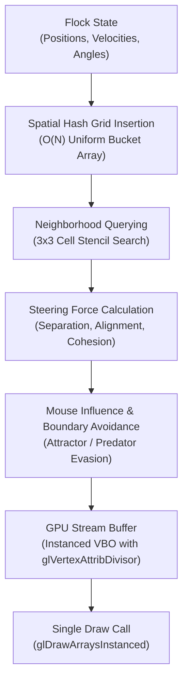

# Boids Flocking Simulator

[](https://en.wikipedia.org/wiki/C%2B%2B17)
[](https://www.opengl.org)
[](https://cmake.org)
[](LICENSE)

A high-performance flocking simulation in modern C++17 and OpenGL 3.3 Core Profile implementing Craig Reynolds' classic Boids model. Accelerates swarm neighborhood queries from $\mathcal{O}(N^2)$ to $\mathcal{O}(N)$ using an allocation-free spatial hash grid and renders 7,000+ interactive boids at 60+ FPS via GPU hardware instancing.

---

## Architecture & Computational Pipeline



---

## Emergent Swarm Behaviors

The simulation computes three fundamental steering vectors per boid:
1. **Separation:** Steers away to prevent crowding and collisions with local flockmates.
2. **Alignment:** Steers towards the average velocity heading of neighboring boids.
3. **Cohesion:** Steers towards the center of mass of local flockmates.

$$\mathbf{F}_{\text{total}} = w_s \mathbf{F}_{\text{separation}} + w_a \mathbf{F}_{\text{alignment}} + w_c \mathbf{F}_{\text{cohesion}} + \mathbf{F}_{\text{cursor}}$$

---

## Technical Highlights

- **Spatial Partitioning ($\mathcal{O}(N)$ Spatial Hashing):** Implements a cache-coherent uniform grid using linked-list bucket arrays (`m_head` and `m_next`). Bypasses all-pairs distance checks with zero runtime heap allocations in the hot loop.
- **Hardware Instanced Rendering:** Renders the entire flock using a single `glDrawArraysInstanced` call. Boid geometry is rotated on the GPU via instanced vertex attributes (`glVertexAttribDivisor`).
- **Dynamic Speed-Gradient Coloring:** Shaders evaluate velocity magnitudes in real-time, smoothly interpolating from calm cyan at cruise speed to fiery orange at peak evasive velocities.
- **Interactive External Influences:** Left-click attracts the flock (food source), while right-click or spacebar repels boids violently (predator scattering).

---

## Controls

| Key / Input | Action |
| :--- | :--- |
| **Left Mouse (Hold)** | Mouse Attractor (Food source) |
| **Right Mouse (Hold)** | Mouse Predator (Scatters flock) |
| **Space** | Instantaneous omnidirectional repulsion blast |
| **1 / 2 / 3** | Preset flock size: 1,500 / 3,500 / 7,000 boids |
| **W** | Toggle screen edge wrapping vs repulsive soft walls |
| **R** | Reset flock positions and velocities |
| **Escape** | Cleanly exit application |

---

## Prerequisites

- **Compiler:** GCC 9+, Clang 10+, or MSVC 2019+ (C++17 support)
- **Build System:** CMake 3.20+
- **Windowing Library:** GLFW 3 (`sudo pacman -S glfw` or `sudo apt install libglfw3-dev`)
- **OpenGL:** Development headers (`libgl-dev` or mesa)

---

## Build & Run

```bash
cd BoidsSimulator
cmake -B build -S . -DCMAKE_BUILD_TYPE=Release
cmake --build build -j$(nproc)
./build/BoidsSimulator
```

---

## License

Distributed under the [MIT License](LICENSE).
